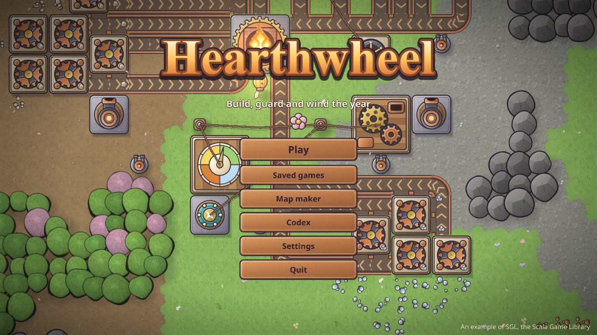
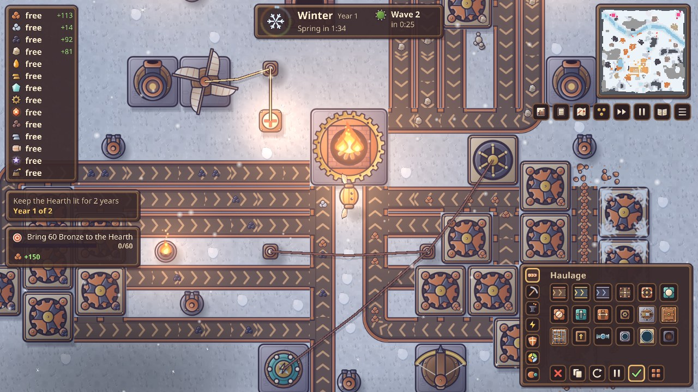
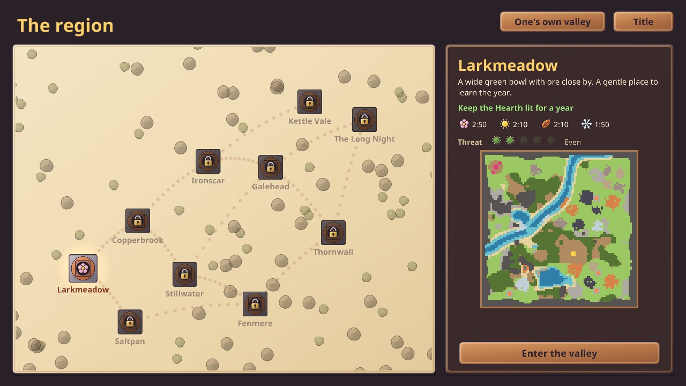
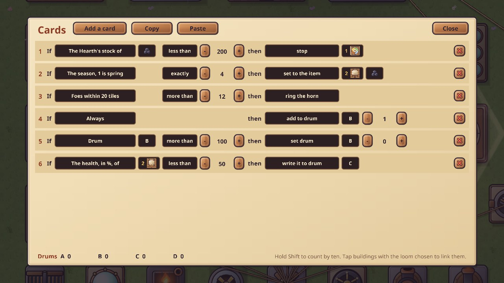

<p align="center">
  <a href="https://regb.github.io/hearthwheel/"></a>
</p>

<p align="center">
  <b>A factory and defense game in valleys where the seasons turn.</b><br>
  Dig, haul and craft with belts, drills and clockwork, guard the Hearth from
  the Bramble, and learn from an almanac that is kept from one valley to the next.
</p>

<p align="center">
  <a href="https://regb.github.io/hearthwheel/">Play in your browser</a> ·
  <a href="https://github.com/regb/scala-game-library">Built with SGL</a>
</p>

<p align="center">
  
  
  
</p>

## The year

What sets it apart is the year. Each season changes the rules for both sides:

| | Works better | What changes |
| --- | --- | --- |
| Spring | Waterwheels, sap taps | The Bramble heals itself |
| Summer | Sun lenses, the Sunlance | Shallows dry out: the richest seams can be dug, and everyone can cross |
| Autumn | Windmills | Seeds ride the wind in great numbers |
| Winter | | Lakes freeze and can be walked over until the ice breaks. Machines without warmth run at half speed |

The Almanac building holds a season back or hurries it on, and the Great Wheel
has four spokes, each to be filled in a season of its own.

H shows the keys in the game, T the almanac, and I the codex. Layouts, maps,
cards and saved games can be shared as text over the clipboard, and F11 goes to
the full screen on the desktop. The game speaks English and French.

## Inspiration

Hearthwheel is a game in the genre of [Mindustry](https://github.com/Anuken/Mindustry),
by Anuken, to which it owes its genre and its measure: [COMPARISON.md](COMPARISON.md)
sets the two side by side, feature by feature. The techniques are those of the
genre too: flow fields, power and fluid graphs, belts simulated item by item.
No code or assets of Mindustry are used. The code, art, sounds, creatures,
machines and maps are this game's own.

## Running it

Hearthwheel is also an example of [SGL, the Scala Game
Library](https://github.com/regb/scala-game-library), and of a large game on
its GameObject engine. It is a Bazel module that depends on SGL as any game
would: see `MODULE.bazel`. Install
[Bazelisk](https://github.com/bazelbuild/bazelisk), then:

| Platform | Command |
| --- | --- |
| Desktop (JVM, LWJGL) | `bazel run //:desktop-lwjgl` |
| Web (Scala.js, WebGL 2) | `bazel run //:html5`, then open `http://localhost:8080` |
| Desktop (Scala Native) | `bazel run //:desktop-native`, with clang, SDL2, SDL2_image and OpenGL ES |
| Tests | `bazel test //...` |

The tests play the game by pointer and keys without a window, on Mesa's
software renderer.

To build against a local checkout of SGL, add this line to `.bazelrc.user`:

```text
common --override_module=sgl.bzl=/path/to/scala-game-library
```

## Layout

- `model/`: the rules, in plain Scala that knows nothing of SGL. Deterministic,
  stepped 60 times a second.
- `view/`: the game on the GameObject engine: scenes and systems, terrain baked
  in chunks, creatures as game objects, an immediate mode interface.
  `view/French.scala` has what is said in French, and a test fails on whatever
  is not in it.
- `tools/`: what makes every picture (`Art.java`) and sound (`audio.py`). Run
  them again after a change:

  ```bash
  java tools/Art.java assets/sprites view/Sheet.scala
  python3 tools/audio.py assets/audio
  ```
- `test/`: the rules, and the game played without a window.

## Stress

```bash
EGL_PLATFORM=surfaceless DISPLAY= bazel run //:stress -- --belts 6000 --creatures 1500 --turrets 400
EGL_PLATFORM=surfaceless DISPLAY= bazel run //:capture -- /tmp/pictures
bazel run //:balance
bazel run //:siege
```

`stress` measures the rules alone, then whole frames with everything in view.
`capture` draws scenes to files, `balance` plays the valleys with bots, and
`siege` tells what it takes to hold each wave.

## License

Hearthwheel is free software under the [GNU General Public License, version 3](LICENSE).
